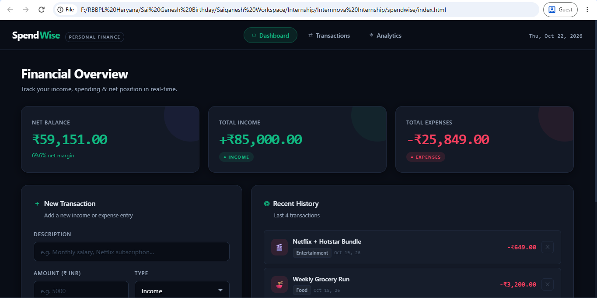
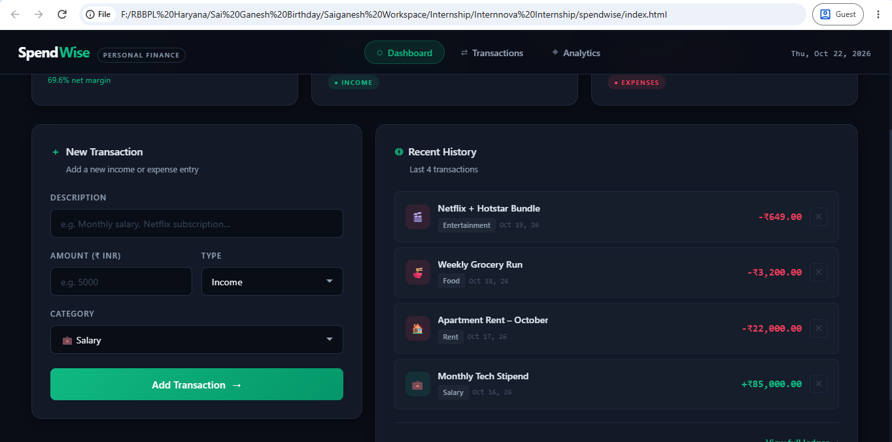
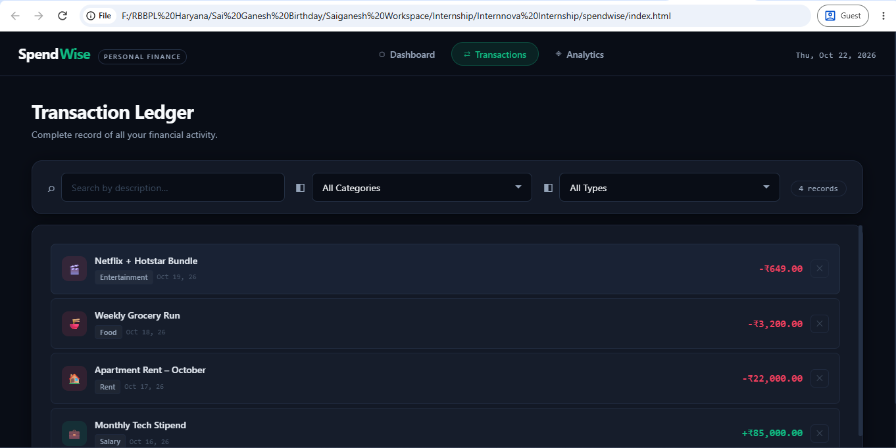
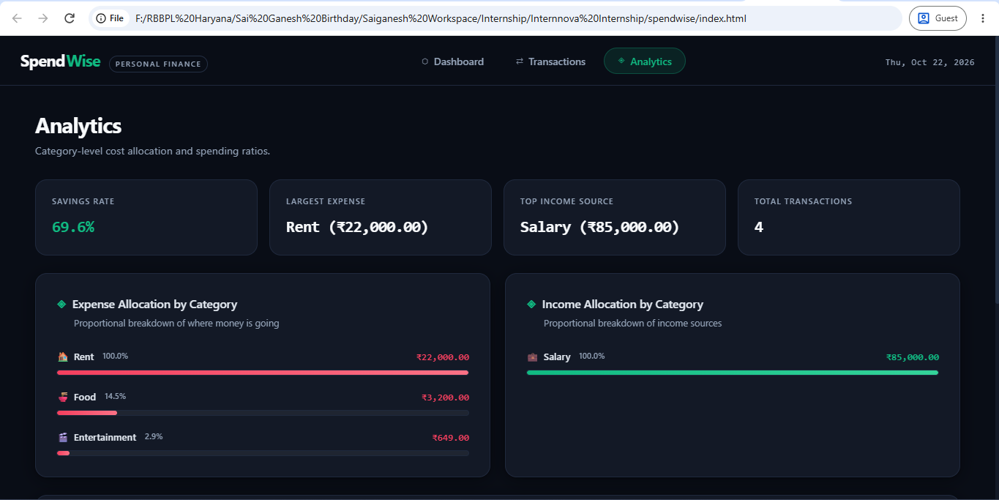

# 💰 SpendWise Tracker - InternNova Final Project

### 🔗 Quick Resource Access Links
*   **GitHub Repository Link:** https://github.com/Saiganesh2418/Spendwise-Internnova-Final-Project
*   **Live Web Deployment Link:** https://saiganesh2418.github.io/Spendwise-Internnova-Final-Project/

---

## 📁 Repository Structure & Organization (Task 2)
```text
spendwise/
│
├── assets/             # Project interface screenshots & graphics
│   ├── screenshot1.png # Desktop UI View
│   ├── screenshot2.png # Mobile Responsive Breakpoint View
│   ├── screenshot3.png # Transaction Adding Flow
│   └── screenshot4.png # Dynamic Deletion Interactivity Test
│
├── index.html          # Semantic HTML5 content layout (Task 3)
├── style.css           # Grid, Flexbox, & Media Queries styling (Task 3)
├── script.js          # JS tracking logic, CRUD actions, & events (Task 4)
└── README.md           # Fulfills Task 2, Task 5, & Task 6 Documentation
```

---

## 📸 Website System Screenshots (Task 6 Evaluation)

### 🖥️ 1. Main Dashboard View (Desktop)


### 📱 2. Fluid Layout System Breakpoint


### ✍️ 3. Transaction Ledger


### 🗑️ 4. Analytics


---

## 📄 Final Project Documentation & Reflection Report (Task 6)

SpendWise Tracker is an interactive personal finance management web application designed to help users track cash flows, log incomes and expenses, and view real-time balance calculations. 

### 💻 Technologies & Features
*   **HTML5/CSS3:** Utilizes semantic elements, CSS Grid, Flexbox, and Media Queries for full responsiveness.
*   **JavaScript:** Vanilla ES6+ handles dynamic DOM updates, form validations, array tracking, and interactive row deletions.
*   **Challenges & Learnings:** Addressed input data type concatenation by implementing `parseFloat()` conversion. Future updates will introduce `localStorage` support and chart visualizations.
